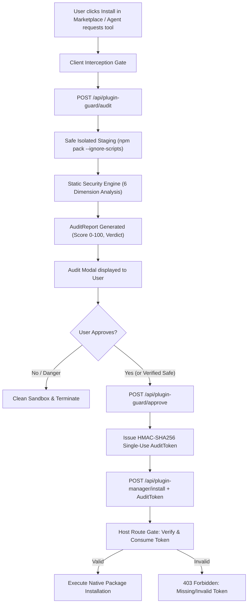

# dsh-plugin-guard 🛡️

<p align="center">
  <b>English</b> &nbsp;•&nbsp; <a href="README.zh.md">简体中文</a>
</p>

<p align="center">
  <a href="https://github.com/Ronnoc/dsh-plugin-guard/actions/workflows/ci.yml"></a>
  <a href="LICENSE"></a>
  <a href="https://www.npmjs.com/package/dsh-plugin-guard"></a>
  <a href="https://github.com/topics/dsh-plugin"></a>
  <a href="https://github.com/topics/cordis-plugin"></a>
</p>

> **Pre-installation Security Audit & Interception Gate Middleware for DeepSeek Harness (DSH) Plugins.**  
> *DeepSeek Harness (DSH) 插件安装前置安全预审与门禁拦截中间件。*

---

## 🎯 Background & The Threat Model

Plugins in **DeepSeek Harness (DSH)** run with the user's full local process privileges in Node.js. In standard DSH installations, when a user clicks "Install" in the marketplace or an AI Agent installs an extension, DSH invokes the package manager directly.

This exposes users to critical supply-chain risks:
1. **Zero Pre-installation Verification**: DSH's native plugin manager only performs trivial string sanity checks (e.g., prohibiting shell metacharacters like `&|;<`), with zero code analysis or behavioral scanning before unpacking.
2. **Post-install Code Execution**: Malicious packages can use npm lifecycle hooks (`preinstall`, `postinstall`) to execute arbitrary code before the user or host can inspect them.
3. **Master Credential Exfiltration**: Malicious plugins can probe `~/.dsh/agy`, `~/.dsh/credentials.yaml`, SSH private keys (`~/.ssh/id_*`), and terminal history.
4. **Unconstrained Subprocesses & MCP Abuse**: Plugins can register destructive MCP tools (arbitrary shell commands, disk wipe) without user visibility.

---

## ✨ Features

- 📦 **Safe Sandbox Staging**: Fetches pristine tarballs via `npm pack --ignore-scripts` into an isolated temporary staging sandbox. Guarantees zero code execution during audit.
- 🔍 **6-Vector Static Analysis Engine**:
  - **Credentials & Secrets**: Detects access to DSH master credentials, Antigravity tokens, SSH keys, cloud API secrets.
  - **Subprocess & Execution**: Flags `child_process`, `exec`, `spawn`, `eval`, and dynamic unsafe code paths.
  - **Lifecycle Hook Guard**: Flags malicious `preinstall` / `postinstall` script execution vectors.
  - **External Endpoints & C2**: Discovers unapproved outbound network requests, WebSockets, and telemetry URLs.
  - **Privilege & Permission Escalation**: Detects attempts to tamper with prompt confirmation gates or bypass permission checks.
  - **MCP Tool Capability Audit**: Inspects exported Model Context Protocol tools for destructive capabilities.
- 🔐 **Tamper-Proof Approval Tokens**: Generates single-use, cryptographically signed (HMAC-SHA256) approval tokens binding `package@version` and pristine tarball SHA-256. Prevents replay attacks and TOCTOU tampering.
- ⚡ **Multi-Dimensional Local Disk Cache (4-Vector Addressing)**: Composite content-addressed caching keyed by `(model, plugin-guard version, plugin spec, tarballSha256)`.
  - **Zero Duplicate I/O & Zero AI Token Waste**: Auditing identical package tarballs under the same model hits disk cache in milliseconds without re-extraction or repeated LLM calls.
  - **Rule Version Invalidation**: Automatic cache invalidation when rules or guard version update.
  - **Model Isolation**: Segregates verdicts across `static` rule engine and LLM models (`deepseek-chat`, `deepseek-reasoner`, etc.).
- 🚪 **Dual-Layer Interception Gate**:
  - **Client UI Layer**: Injects pre-install review prompt into the DSH marketplace, presenting findings before package installation.
  - **Host Route Gate**: Intercepts `/api/plugin-manager/install` on the host side, rejecting any installation request that lacks a valid approval token.

---

## 🏗️ Architecture



---

## 🚀 Installation & Setup

### As a DSH Plugin (Recommended)

Add `dsh-plugin-guard` to your DSH profile declaration or install via CLI:

```bash
# Add to current profile
dsh plugin add dsh-plugin-guard
```

Or declare it in your `cordis.patch.yml`:

```yaml
- insert:
    - id: dsh-plugin-guard
      name: dsh-plugin-guard
      config:
        strictMode: true          # Automatically block packages with CRITICAL findings
        scanOnInstall: true       # Enforce audit gate on install
        scanOnUpdate: true        # Enforce audit gate on updates
        allowedDomains:
          - "registry.npmjs.org"
          - "github.com"
          - "api.github.com"
          - "dsh-market.com"
```

---

## ⚙️ Configuration Options

| Option | Type | Default | Description |
| :--- | :--- | :--- | :--- |
| `strictMode` | `boolean` | `true` | If true, packages with `CRITICAL` findings cannot be installed without explicit forced bypass. |
| `scanOnInstall` | `boolean` | `true` | Intercepts and audits all incoming plugin installations. |
| `scanOnUpdate` | `boolean` | `true` | Intercepts and audits plugin update operations. |
| `allowedDomains`| `string[]` | `['registry.npmjs.org', 'github.com', 'api.github.com', 'dsh-market.com']` | Domain allowlist for network requests found in plugins. |
| `stagingTtlMs` | `number` | `300000` (5m) | Time-to-live for staged files and approval tokens. |
| `tokenSecret` | `string` | *(auto-generated)* | Cryptographic key used to sign approval tokens. |

---

## 📊 Audit Report Schema

```typescript
export type AuditVerdict = 'SAFE' | 'CAUTION' | 'DANGEROUS'

export interface AuditReport {
  spec: string                  // e.g. "my-plugin@1.2.0"
  packageName: string           // "my-plugin"
  version: string               // "1.2.0"
  tarballSha256: string         // SHA-256 digest of original tarball
  verdict: AuditVerdict         // 'SAFE' | 'CAUTION' | 'DANGEROUS'
  score: number                 // 0 to 100
  findings: AuditFinding[]      // Detailed security findings
  permissions: {
    network: string[]           // Extracted external domains
    filesystem: string[]        // Sensitive paths touched
    subprocesses: boolean       // Whether child processes are spawned
    mcpTools: string[]          // Declared MCP tools
  }
  auditToken?: string           // Single-use token issued upon approval
}
```

---

## 🧪 Testing

```bash
# Run test suite with Vitest
npm test

# Run TypeScript type check
npm run typecheck

# Build library distribution
npm run build
```

---

## 🌐 Languages / 多语言文档

- [English (Current)](README.md)
- [简体中文 (Chinese)](README.zh.md)

---

## 📄 License

Licensed under the [Apache License, Version 2.0](LICENSE).
