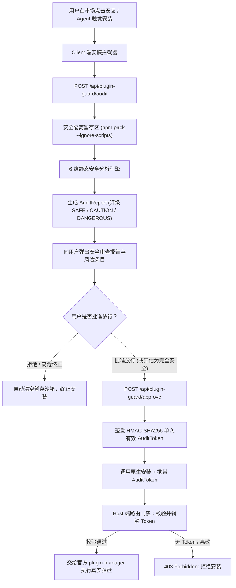

# dsh-plugin-guard 🛡️

[](https://github.com/Ronnoc/dsh-plugin-guard/actions/workflows/ci.yml)
[](LICENSE)
[](https://www.npmjs.com/package/dsh-plugin-guard)
[](https://github.com/topics/dsh-plugin)
[](https://github.com/topics/cordis-plugin)

> **DeepSeek Harness (DSH) 插件安装前置安全预审与门禁拦截中间件。**

---

## 🎯 背景与威胁模型

在 **DeepSeek Harness (DSH)** 体系中，插件以当前宿主 Node.js 进程的高特权身份执行。在原生 DSH 架构下，用户在市场点击“安装”或 Agent 自主安装插件时，DSH 会直接调用底层包管理器执行安装并加载。

这带来了极为严重的供应链安全隐患：
1. **安装前零代码审查**：原生 `dsh-plugin-manager` 仅做了基础的命令行特殊字符过滤（如检测 `&|;<`），对插件包的代码逻辑、网络行为和文件访问没有任何前置分析。
2. **生命周期代码执行漏洞**：恶意 npm 包可以通过 `preinstall` / `postinstall` 脚本在安装期静默执行任意 shell 命令，在用户察觉前即可完成提权或破坏。
3. **主密钥与凭据窃取**：未受限的插件可轻而易举探测并外发 `~/.dsh/agy`、`~/.dsh/credentials.yaml`、SSH 私钥 (`~/.ssh/id_*`) 以及系统历史记录。
4. **不可信 MCP 工具暴露**：恶意插件可声明具备破坏性的 MCP 工具（如无约束任意命令执行、文件抹除），诱导智能体在用户不知情的情况下调用。

---

## ✨ 核心特性

- 📦 **安全沙箱临时暂存**：通过 `npm pack --ignore-scripts` 将目标插件压缩包静态拉取至瞬态隔离目录，解压分析全流程**绝对不触发任何生命周期脚本与代码执行**。
- 🔍 **6 大静态安全规则引擎**：
  - **凭据嗅探防护**：扫描并阻断对 DSH 核心凭证、Antigravity 密钥、SSH 私钥、云厂商 Secret 的访问。
  - **子进程与代码执行**：深度分析 `child_process`、`exec`、`spawn`、`eval` 等高危进程调用。
  - **生命周期门禁**：高危告警 `package.json` 中的 `preinstall` / `postinstall` 自动化脚本。
  - **网络外联与 C2 探测**：提取并比对包内所有外部 URL、WebSocket 与遥测域名，识别未备案端点。
  - **特权越权防范**：检测是否试图篡改权限确认门禁（如伪造 `permissionConfirmedAt` 逃逸审查）。
  - **MCP 工具能力审计**：审查插件暴露给 Agent 的 MCP 工具，识别破坏性命令与文件清理操作。
- 🔐 **防篡改放行凭证（Audit Token）**：基于 HMAC-SHA256 签发单次有效、带时间戳的防重放 Token，强制绑定 `spec` 与压缩包 SHA-256 哈希，彻底杜绝 TOCTOU 替换攻击。
- 🚪 **双层门禁拦截体系**：
  - **Client 端 UI 门禁**：自动包装 DSH 市场安装流，在安装前弹出安全报告，让用户获知威胁等级并自主决断。
  - **Host 端路由门禁**：在宿主 Web 服务中接管 `/api/plugin-manager/install`，凡未携带有效预审 Token 的安装请求一律拒绝（返回 403）。

---

## 🏗️ 架构设计图



---

## 🚀 安装与启用

### 作为 DSH 插件安装（推荐）

通过命令行添加到当前 profile：

```bash
dsh plugin add dsh-plugin-guard
```

或在 profile 的 `cordis.patch.yml` 中声明挂载：

```yaml
- insert:
    - id: dsh-plugin-guard
      name: dsh-plugin-guard
      config:
        strictMode: true          # 发现 CRITICAL 高危漏洞时自动阻断安装
        scanOnInstall: true       # 拦截所有插件安装
        scanOnUpdate: true        # 拦截所有插件更新
        allowedDomains:
          - "registry.npmjs.org"
          - "github.com"
          - "api.github.com"
```

---

## ⚙️ 配置项参数

| 配置项 | 类型 | 默认值 | 作用说明 |
| :--- | :--- | :--- | :--- |
| `strictMode` | `boolean` | `true` | 严格模式：发现 `CRITICAL` 级别威胁时禁止常规放行，必须显式 force 覆盖。 |
| `scanOnInstall` | `boolean` | `true` | 是否对安装请求强制执行安全门禁拦截。 |
| `scanOnUpdate` | `boolean` | `true` | 是否对更新升级操作强制执行安全门禁拦截。 |
| `allowedDomains`| `string[]` | `['registry.npmjs.org', 'github.com']` | 插件网络外联的合规域名白名单。 |
| `stagingTtlMs` | `number` | `300000` (5分钟) | 暂存目录与放行 Token 的有效保留时间。 |
| `tokenSecret` | `string` | *(自动随机生成)* | 用于对防篡改 Token 进行 HMAC 签名的密钥。 |

---

## 📊 审计报告结构 (`AuditReport`)

```typescript
export type AuditVerdict = 'SAFE' | 'CAUTION' | 'DANGEROUS'

export interface AuditReport {
  spec: string                  // 插件版本标识，例如 "my-plugin@1.2.0"
  packageName: string           // 包名
  version: string               // 版本号
  tarballSha256: string         // Pristine Tarball 的 SHA-256 摘要
  verdict: AuditVerdict         // 总体评级：SAFE / CAUTION / DANGEROUS
  score: number                 // 安全评分：0 - 100
  findings: AuditFinding[]      // 具体的漏洞与检查条目清单
  permissions: {
    network: string[]           // 提取出的所有外联域名
    filesystem: string[]        // 涉及的敏感文件系统路径
    subprocesses: boolean       // 是否涉及子进程派生
    mcpTools: string[]          // 暴露的 MCP 工具列表
  }
  auditToken?: string           // 用户审批后签发的放行凭证
}
```

---

## 🧪 本地测试与构建

```bash
# 运行单元测试
npm test

# 执行 TypeScript 类型校验
npm run typecheck

# 编译为生产包
npm run build
```

---

## 📄 开源许可协议

基于 [Apache License, Version 2.0](LICENSE) 开源。
